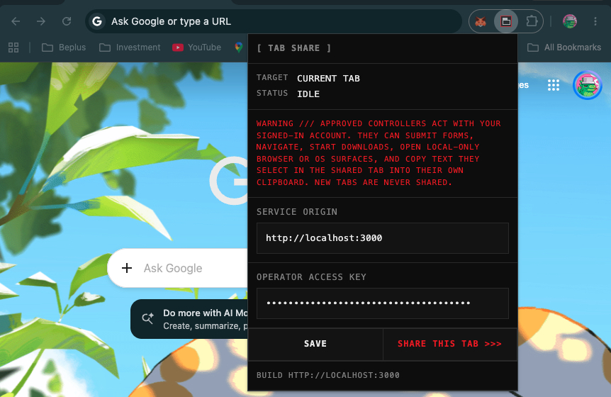
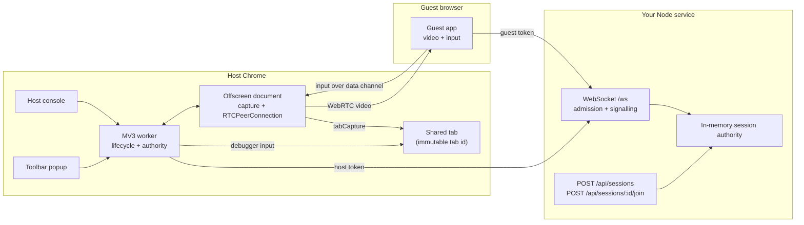
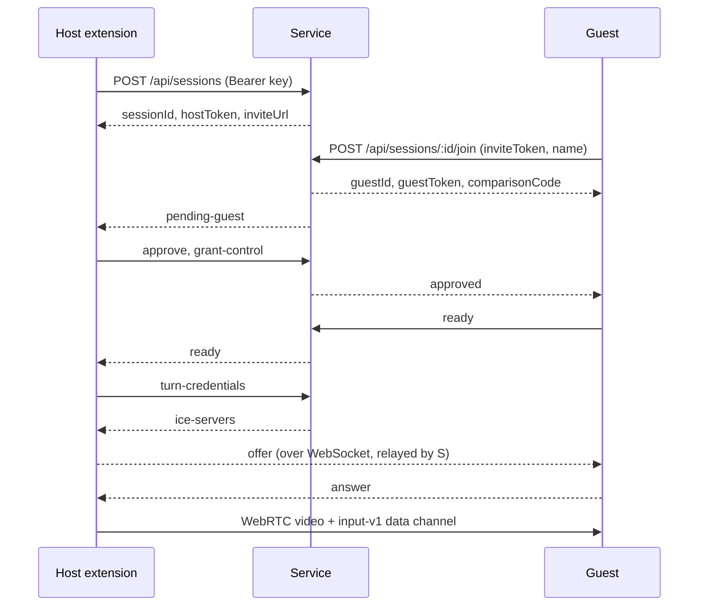

# Tab Share

Share **one** of your existing Chrome tabs with other people. You pick the tab, they open a link or scan a QR code, you approve them, and they see it live. Exactly one approved guest at a time can interact with it — typing, clicking, scrolling, selecting — as if they were sitting at your browser.

It is self-hosted: a small Node service you run yourself handles admission and signalling, and WebRTC carries the picture. No account, no third-party service, no guest install — guests only need a browser.



---

## Contents

- [What this is and is not](#what-this-is-and-is-not)
- [Quick start](#quick-start)
- [Prerequisites](#prerequisites)
- [First run, step by step](#first-run-step-by-step)
- [Sharing with another person](#sharing-with-another-person)
- [Everyday use](#everyday-use)
- [Developing](#developing)
- [Architecture](#architecture)
- [Configuration reference](#configuration-reference)
- [Defaults and limits](#defaults-and-limits)
- [Troubleshooting](#troubleshooting)
- [Deployment](#deployment)
- [Security and compatibility boundary](#security-and-compatibility-boundary)
- [Interface language](#interface-language)

---

## What this is and is not

**What it does**

- Captures the pixels of one tab, and only that tab. Same-tab navigation stays captured; new tabs are never followed.
- Sends the picture to approved guests over WebRTC (DTLS/SRTP), with TURN relay support for networks that need it.
- Replays mouse, wheel, keyboard, scroll, right-click, and committed text input onto the host tab through `chrome.debugger`.
- Lets a guest copy the host's current text selection into their own clipboard, and message the host.
- Keeps guests read-only until the host grants control, and one controller at a time.

**What it does not do**

- No microphone or audio, no desktop control, no browser chrome, no OS dialogs, no native file transfer.
- No clipboard synchronisation. Copy is one direction only, from a host selection the guest explicitly asks for.
- No DOM access for the guest. They see pixels; they cannot read the page.
- No persistence. Session state is in memory; restarting the service ends every session.

**Important:** an approved controller acts with your signed-in account on that tab. See [Security and compatibility boundary](#security-and-compatibility-boundary).

---

## Quick start

Two terminals. Replace `YOUR_EXTENSION_ID` after step 3 of [First run](#first-run-step-by-step).

```sh
# once
npm install

# terminal 1 — service (guest app + API + WebSocket on :3000 and :5173)
ALLOWED_EXTENSION_IDS=YOUR_EXTENSION_ID npm run dev

# terminal 2 — test pages to share
npm run fixtures
```

Then, in Chrome:

1. `chrome://extensions` → enable **Developer mode** → **Load unpacked** → choose `apps/extension/dist`.
2. Copy the extension's ID into `ALLOWED_EXTENSION_IDS` and restart terminal 1.
3. Open `http://localhost:4100/tab.html`.
4. Click the Tab Share toolbar icon, click **SHARE THIS TAB >>>**.
5. Open the invitation link in another browser or profile, enter a name, request access, and approve it in the host console.

The two non-obvious requirements, both explained in [Troubleshooting](#troubleshooting): the service must be started **with your extension's ID**, and the invitation link must keep its `#invite=…` fragment.

---

## Prerequisites

| Requirement | Notes |
| --- | --- |
| **Node.js 24+** | `package.json` declares `engines.node >= 24`. Check with `node --version`. |
| **npm 10+** | Ships with Node 24. |
| **Chrome 125+** | Needs flat CDP sessions (`chrome.debugger` `sessionId`) and offscreen documents. Check `chrome://version`. |
| **A second browser or profile** | Guests must not share the host's Chrome profile, or they would be the same session. Mobile Chrome and Safari work too. |

Nothing else. TURN is only needed for guests outside your network; the service falls back to an empty ICE server list in development so same-machine testing works without a relay.

---

## First run, step by step

### 1. Install and build

```sh
npm install
npm run build
```

`npm run build` compiles the protocol package, then the server, the guest app, and the extension. The extension lands in `apps/extension/dist`.

### 2. Start the service

```sh
npm run dev
```

That builds the protocol and extension once, then runs the API/WebSocket server on **:3000** and the guest app with hot reload on **:5173**. You should see:

```text
tab-share server listening on 3000
Local:   http://localhost:5173/
```

Leave this running.

### 3. Load the extension

1. Go to `chrome://extensions`.
2. Turn on **Developer mode** (top right).
3. Click **Load unpacked** and select the `apps/extension/dist` folder inside this repository.
4. The Tab Share card appears with an **ID** such as `egkililnijdmeljnfnipgebgpjbgkngo`. Copy it.

If Chrome reports an error instead, confirm you selected `dist` and not the repository root, and that `npm run build` finished.

### 4. Authorise your extension ID

Stop the service (Ctrl+C) and start it again with your ID:

```sh
NODE_ENV=development \
HOST_ACCESS_KEY=development-host-access-key-change-me \
ALLOWED_EXTENSION_IDS=egkililnijdmeljnfnipgebgpjbgkngo \
npm run dev
```

The service reads `ALLOWED_EXTENSION_IDS` **only at startup**, which is why it must be restarted. Without this, the popup reports:

> This extension is not authorized by the dev server. Restart it with ALLOWED_EXTENSION_IDS=…

Unpacked extension IDs are stable for a given folder, so you only do this once.

### 5. Serve test pages

In a second terminal:

```sh
npm run fixtures
```

This serves `http://localhost:4100/tab.html` (with a labelled counter, inputs, a slider, drag targets, and a cross-site iframe), `http://localhost:4100/unrelated.html` for isolation checks, and its cross-site frame on `http://127.0.0.1:4101`.

### 6. Share it

1. Open `http://localhost:4100/tab.html`. **Use `localhost`, not `127.0.0.1`** — the development service only trusts `http://localhost:5173`, and the guest page loads from there.
2. Click the Tab Share toolbar icon.
3. The panel shows the tab it selected and the debugger warning. Click **SAVE** once if the fields are empty, then **SHARE THIS TAB >>>**.

Fill the two fields if needed:

| Field | Development value |
| --- | --- |
| Service origin | `http://localhost:3000` |
| Operator access key | `development-host-access-key-change-me` |

Pressing **SHARE THIS TAB >>>** saves the fields, checks the service authorises this extension build, captures the tab, attaches the debugger, opens a session, and shows the host console with a QR code. If the debugger prompt or the capture permission appears, accept it.

A **LIVE** badge appears on the toolbar icon while sharing.

---

## Sharing with another person

The host console shows a QR code, the invitation URL, and a **COPY CHANNEL URL** button. Send that URL to your guest, or let them scan the QR code.

The guest then:

1. Opens the link and enters a display name.
2. Sees a six-digit comparison code and waits.
3. You see their name and code under **PENDING REQUESTS** and click **APPROVE**.
4. They start receiving the picture. They are **read-only** until you click **GRANT CONTROL**.

The comparison code is an out-of-band aid for telling two guests with the same name apart. It is not a secret and not authentication.

On the guest side, a single `[ GUIDE ]` button opens one panel that documents how to interact and holds the few actions that need a button: send a message to the host, request control, and leave. Desktop users keep keyboard shortcuts; touch devices additionally get explicit RIGHT CLICK, COPY SELECTION, SELECT ALL, KEYBOARD, and FULL SCREEN.

---

## Everyday use

**Host (toolbar panel).** Shows the state and lets you reopen the console or stop sharing. Stopping is immediate and needs no confirmation.

**Host console.** Live state, the QR code and invitation URL, invitation expiry with **ROTATE INVITATION**, pending requests with APPROVE / REJECT, approved viewers with GRANT CONTROL / REVOKE / REMOVE, a guest message log, and **STOP SHARING**.

**Guest.** Read-only until granted control. Then: click and type normally; drag to select text; `^C` copies the host's selection to your clipboard; `^A` selects all in the focused frame; right-click or `^`-click opens the page's context menu **on the host's screen**; on touch, one finger scrolls in SCROLL mode and drags in DRAG mode.

**Ending.** Closing the shared tab, closing the console, stopping sharing, a host disconnect, the 2-hour session expiry, or the debugger detaching all end the session and clear the guest's view. There is no automatic rejoin: a guest requests access again, and you approve again.

---

## Developing

### Scripts

| Command | What it does |
| --- | --- |
| `npm install` | Install all workspaces. |
| `npm run build` | Protocol → server → guest app → extension. |
| `npm run dev` | Builds protocol + extension once, then runs the server (`tsx watch`) and the guest app (Vite, HMR) together. |
| `npm run fixtures` | Serves the test pages on `:4100` and their cross-site frame on `:4101`. |
| `npm run test` | Vitest, once. |
| `npm run typecheck` | `tsc --noEmit` across every workspace. |
| `npm run build -w @tab-share/<name>` | Rebuild one workspace. |

### Workspaces

```text
packages/protocol   Zod wire contracts and inferred types — the only shared code
apps/server         Express API + ws signalling + TURN credentials + session authority
apps/extension      MV3: worker, debugger input, offscreen WebRTC owner, popup, console
apps/web            Guest client (React + Vite)
deploy/             Caddy + coturn compose stack
tests/fixtures/     Pages to share while testing
tools/make-icons.mjs  Deterministic extension icon generator
```

### The one thing that trips people up

`npm run dev` builds the **extension once**. It does not watch it, because Chrome only re-reads an unpacked extension when you reload it. After changing anything under `apps/extension/src`, run:

```sh
npm run build -w @tab-share/extension
```

then click **Reload** on the Tab Share card at `chrome://extensions`. The guest app hot-reloads on its own.

### Tests

Vitest runs three suites, all behavioural rather than snapshot-based:

- `packages/protocol/src/index.test.ts` — schema boundaries: unknown keys, protocol versions, out-of-range coordinates, oversized payloads, script-bearing input rejected.
- `apps/server/src/sessions.test.ts` — the session authority: invite rotation invalidates old tokens, one controller with monotonic epochs, tokens die at session end, the fifth approval is refused.
- `apps/web/src/geometry.test.ts` — the stage geometry: pillarboxing, letterboxing, exact-fit, letterbox clicks rejected, and exact round-tripping when frame and viewport aspects disagree.

Add a test when a behaviour is a contract. The coordinate maths is the piece most likely to regress silently, so it lives in `apps/web/src/geometry.ts` as pure functions with no DOM dependency.

### Working on the protocol

`packages/protocol/src/index.ts` is the single source of truth for every message on the wire and on the data channel. It has no dependencies beyond Zod and no privileged code, so the extension and the guest app can both import it safely.

Both sides validate with `.strict()`, which rejects unknown keys. To add a message: add the schema, rebuild the protocol package (`npm run build -w @tab-share/protocol`), then use the inferred type at both ends — the compiler will point at every place that needs updating.

---

## Architecture



### Handshake



The host builds the peer only on `ready`. An offer sent before the guest's socket authenticated would be dropped with nothing to retry it, so readiness — not approval — is the trigger.

### Where authority lives

- **The service** decides who is in a room and who may see anything. Roles come from token lookup, never from the client. Pending guests receive no SDP, ICE, TURN credentials, or media.
- **The extension worker** is the final authority over input. It validates the controller, session, epoch, viewport epoch, and sequence immediately before dispatching, and a local stop or revoke invalidates authorisation synchronously before any network acknowledgement.
- **The offscreen document** owns the capture track and the peers, so the worker can restart without leaking capture state.
- **The guest** only normalises coordinates and sends intent. It cannot name arbitrary targets or reach any Chrome API.

---

## Configuration reference

### Service environment

Set these for `npm run dev` or for the container. In development most have working defaults.

| Variable | Default (development) | Required in production | Purpose |
| --- | --- | --- | --- |
| `NODE_ENV` | — | yes | Anything other than `production` enables development permissiveness. |
| `PORT` | `3000` | no | HTTP/WebSocket port. |
| `PUBLIC_ORIGIN` | `http://localhost:5173` | yes | Guest app origin. Used to build invitation URLs and to validate WebSocket `Origin`. Must be `https://` in production. |
| `HOST_ACCESS_KEY` | `development-host-access-key-change-me` | yes | Bearer key that authorises `POST /api/sessions`. Must be ≥32 characters in production. |
| `ALLOWED_EXTENSION_IDS` | *(empty)* | yes | Comma-separated unpacked/production extension IDs allowed to call the API and open the WebSocket. |
| `TURN_HOST` | *(empty)* | yes | TURN/STUN hostname handed to clients. Empty in development yields `iceServers: []` with a diagnostic. |
| `TURN_SHARED_SECRET` | *(empty)* | yes | coturn `static-auth-secret`; used to mint short-lived HMAC credentials. Must be ≥32 characters. |
| `TURN_TLS_PORT` | `5349` | no | TURNS port advertised to clients. |
| `MAX_GUESTS` | `4` | no | Approved viewers per session. |
| `MAX_SESSIONS` | `10` | no | Concurrent sessions. |
| `SESSION_TTL_SECONDS` | `7200` | no | Session lifetime. |
| `INVITE_TTL_SECONDS` | `600` | no | Invitation lifetime, also used when rotating. |

Production startup fails fast if `PUBLIC_ORIGIN` is not HTTPS, `HOST_ACCESS_KEY` is shorter than 32 characters, or `TURN_HOST` / `TURN_SHARED_SECRET` are missing. That is deliberate: a silently insecure deployment is worse than a refused boot.

### Extension build environment

| Variable | Default | Purpose |
| --- | --- | --- |
| `SERVICE_ORIGIN` | `http://localhost:3000` | Baked into the build. Sets `host_permissions`, the extension CSP `connect-src`, and the only origin the popup will accept. |

```sh
SERVICE_ORIGIN=https://share.example.com npm run build -w @tab-share/extension
```

The origin is fixed at build time on purpose, so the extension cannot be talked into contacting an arbitrary host. Changing it requires a rebuild, not a setting.

---

## Defaults and limits

| Limit | Value | Where |
| --- | --- | --- |
| Approved viewers per session | 4 | `MAX_GUESTS` |
| Concurrent sessions | 10 | `MAX_SESSIONS` |
| Pending requests per session | 8 | `apps/server/src/sessions.ts` |
| Pending request lifetime | 120 s | `apps/server/src/sessions.ts` |
| Invitation lifetime | 600 s | `INVITE_TTL_SECONDS` |
| Session lifetime | 7200 s | `SESSION_TTL_SECONDS` |
| Guest display name | 1–40 characters | protocol schema |
| Guest message | 1–280 characters, 5 per guest per minute | protocol + signalling |
| Host key usage | 5 session creations per minute | `apps/server/src/server.ts` |
| Guest joins | 10 per IP per minute | `apps/server/src/server.ts` |
| Unauthenticated sockets | 5 per IP | `apps/server/src/signaling.ts` |
| WebSocket frame size | 64 KiB | `apps/server/src/signaling.ts` |
| Signalling messages | 300 per connection per minute | `apps/server/src/signaling.ts` |
| Clipboard payload | 60,000 characters, truncated flag set | protocol schema |
| Guest input message | 8 KiB | protocol schema |
| Auth deadline | 5 s to send `auth` or the socket closes | `apps/server/src/signaling.ts` |
| Heartbeat | 5 s WebSocket ping; 15 s offscreen heartbeat | `apps/server/src/signaling.ts`, offscreen |
| Session socket queue | closed above 1 MiB buffered | `apps/server/src/signaling.ts` |

All limits are in memory. There is no database and no persisted permission, so a restart cannot resurrect a session that a host already ended.

---

## Troubleshooting

### The popup says the extension is not authorised

```text
This extension is not authorized by the dev server. Restart it with
ALLOWED_EXTENSION_IDS=<your id>
```

The service reads that variable once, at startup. Copy the ID from the Tab Share card at `chrome://extensions`, then restart `npm run dev` with `ALLOWED_EXTENSION_IDS=<id>`.

### “Configure the operator access key first”

The key field was empty when you pressed **SHARE THIS TAB >>>**. Enter `development-host-access-key-change-me` (or whatever you set `HOST_ACCESS_KEY` to). The panel saves it for you, so no separate **SAVE** is needed.

### The guest sees “Link lost” immediately

The guest page origin is not trusted. In development the service only accepts `http://localhost:5173`. Open the invitation using `localhost`, not `127.0.0.1`, and make sure you did not open the built app on port 3000.

### The guest is stuck on “Approved. Negotiating media…”

Ordinary causes, in order:

1. The guest's ICE cannot reach the host — expected across restrictive NATs without TURN. Set `TURN_HOST` and `TURN_SHARED_SECRET`, or test both sides on the same machine.
2. The peer connection failed. The guest's **LINK** readout and the console log show the state; a 20-second setup deadline reports a timeout rather than hanging.
3. The extension was rebuilt but not reloaded at `chrome://extensions`.

The handshake waits for an explicit `ready` from the guest, so ordering is not a cause.

### Clicks land in the wrong place

Check the guest's `SCALE` readout: it shows the reported host viewport and the actual frame size. If they disagree by more than 1% the readout turns red and a notice appears, which means the captured frame does not correspond one-to-one with the tab viewport — usually a stale extension build or a third-party tool modifying the capture. Reload the extension and restart sharing.

### The picture is stretched

It cannot be, by construction — the picture is drawn at the video's own aspect. If it looks wrong, the frame itself is wrong: reload the extension so the capture applies no scaling constraints, and restart sharing.

### Right-click does nothing visible

It works, but the menu opens on the **host's** screen. That is a native browser menu and cannot be forwarded. The host dismisses it with Escape.

### “Nothing selected in the shared tab”

Copy reads the host's current selection. Drag over the text in the shared tab first, then press `^C` in the guide panel or use **COPY SELECTION**.

### Notifications for guest messages do not appear

The extension needs the `notifications` permission, which is in the manifest — so reload the extension at `chrome://extensions` after a rebuild. Messages are also kept in the console's `[ GUEST MESSAGES ]` section, so nothing is lost.

### Everything works, then stops after a while

Expected. An invitation lasts 10 minutes until rotated; a session lasts 2 hours; a pending request expires after 2 minutes; closing the console or the shared tab ends the session. Press **ROTATE INVITATION** for a fresh link.

---

## Deployment

Target: a Linux VPS with a static public IPv4, real DNS, and TLS material for the TURN hostname.

### 1. DNS and firewall

Point `APP_DOMAIN` and `TURN_HOST` at the VPS. Open:

| Port | Protocol | Purpose |
| --- | --- | --- |
| 80, 443 | TCP | Caddy: certificates and the guest app. |
| 3478 | TCP + UDP | TURN. |
| 5349 | TCP | TURN over TLS. |
| 49160–49239 | UDP | TURN relay range. |

### 2. Configure

```sh
cp deploy/.env.example deploy/.env
$EDITOR deploy/.env
```

Fill in `APP_DOMAIN`, `TURN_HOST`, `TURN_LISTEN_IP`, `ALLOWED_EXTENSION_IDS`, and 32+ character random values for `HOST_ACCESS_KEY` and `TURN_SHARED_SECRET`. Point `TURN_CERT_PATH` and `TURN_KEY_PATH` at a publicly trusted certificate; coturn refuses to start without them rather than pretending TLS is up.

### 3. Build the extension against your origin

```sh
SERVICE_ORIGIN=https://share.example.com npm run build -w @tab-share/extension
```

Load `apps/extension/dist` unpacked and add that extension ID to `ALLOWED_EXTENSION_IDS`.

### 4. Start

```sh
docker compose --env-file deploy/.env -f deploy/compose.yml config   # validate
docker compose --env-file deploy/.env -f deploy/compose.yml up --build -d
```

Three services: **Caddy** terminates HTTPS and proxies to the app, **app** serves the guest app, API and WebSocket, and **coturn** runs with host networking for the relay.

### NAT and port-443-only networks

On a direct public IP no `external-ip` is needed. Behind 1:1 NAT add coturn's `external-ip=PUBLIC/PRIVATE` while preserving relay port numbers. If a guest's network allows only port 443, run coturn on a second public IP with `TURN_TLS_PORT=443` — do not proxy TURN through Caddy. There is no managed-relay fallback.

---

## Security and compatibility boundary

- **Video only.** No microphone, desktop, browser chrome, clipboard synchronisation, native file transfer, or OS-dialog control.
- **One tab, fixed.** Capture is bound to an immutable tab id. New tabs are never followed; same-tab navigation stays captured.
- **The controller uses your account.** Remote actions can submit forms, navigate, start downloads, and trigger local-only permission surfaces on that tab. Approve only people you would hand the keyboard to.
- **Pending guests get nothing.** No media, SDP, ICE, or TURN credentials until approved.
- **Tokens are capabilities, not identifiers.** Host, guest, and invite tokens are independent 32-byte random values, stored server-side as SHA-256 digests and compared in constant time. No token appears in a URL except the invite token, which grants nothing on its own.
- **Memory only.** Restarting the service ends every session.
- **Transport.** WebRTC media is DTLS/SRTP, including through TURN, but there is no independent identity or end-to-end guarantee against a malicious operator of the signalling service. Direct ICE can reveal peer network addresses to each other.
- **`chrome.debugger` is unsupported for this use.** Chrome's CDP documentation explicitly calls end-user interaction outside a debugger unsupported and warns the protocol can change without compatibility guarantees. Enterprise policy can block it. This is an unpacked local extension and is **not** represented as Chrome Web Store approved.
- **Some pages will not work.** Protected pages, DRM surfaces, file pickers, native dialogs, and some HTML5 drag operations are out of reach.

---

## Interface language

All three surfaces — the guest window, the toolbar panel, and the host console — follow Tactical Telemetry / CRT terminal guidelines:

- Dark CRT substrate (`#0a0a0a`, `#121212`, `#1a1a1a`) with `#eaeaea` phosphor text.
- Monospace throughout; uppercase metadata with generous tracking.
- Hazard red `#e61919` as the only accent, reserved for primary actions, alert borders, and vital readouts.
- Terminal green `#4af626` on exactly one element: the `CONTROL` readout when control is granted.
- Zero border radius; no decorative gradients, translucency, or drop shadows.
- Compartmentalisation through solid 1px borders and 1px grid gaps over contrasting surfaces.
- ASCII framing (`[ INVITATION ]`, `>>>`, `///`) and semantic `<data>`, `<samp>`, `<kbd>`, `<output>`, `<dl>` markup.
- A faint scanline overlay over the video plane only, below every text layer, so readouts stay crisp.

Text contrast is 4.5:1 or better everywhere, including disabled controls, which are dimmed rather than faded to unreadable. No web fonts are loaded: the monospace stack is system-local, keeping the guest free of third-party requests.

---

## Verification fixtures

`npm run fixtures` serves:

| URL | Purpose |
| --- | --- |
| `http://localhost:4100/tab.html` | The page to share: labelled counter, text input, textarea, contenteditable, long scroll region, range slider, pointer-drag target, HTML5 draggable and drop target, same-tab navigation link, new-tab link, file picker, JS dialog, and a cross-site iframe. |
| `http://localhost:4100/unrelated.html` | A second, independent counter for isolation checks: activity must never appear here. |
| `http://localhost:4100/geometry.html` | Forty stacked bands, one per 2.5% of the viewport height, plus `?scroll=1` for a scrollbar. Used to measure pointer accuracy in pixels. |
| `http://127.0.0.1:4101/frame.html` | A cross-site frame, on a different host, to confirm input and selection reach child frames. |

Keep a second unrelated tab open in the same window while testing: capture and input must stay bound to the selected tab.
